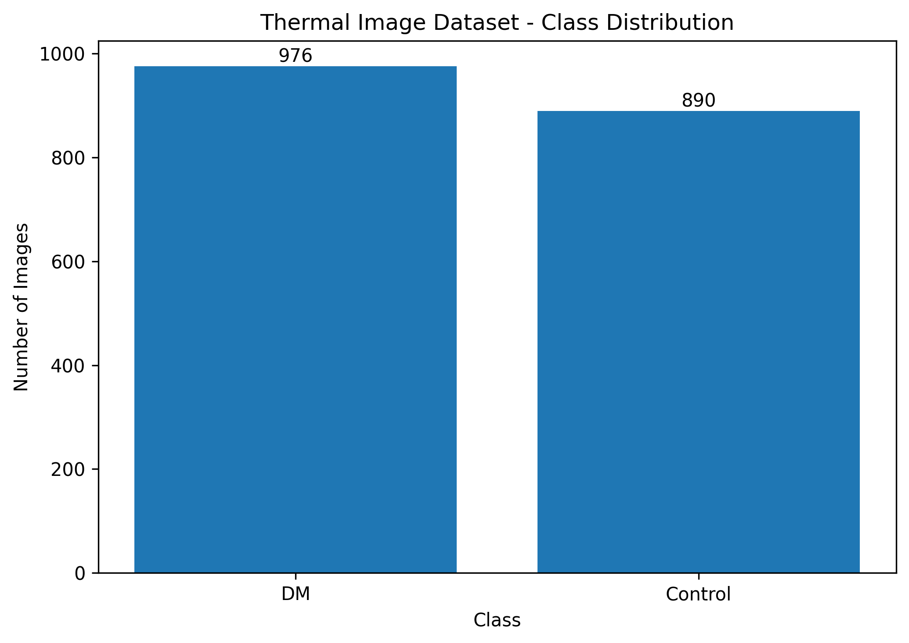
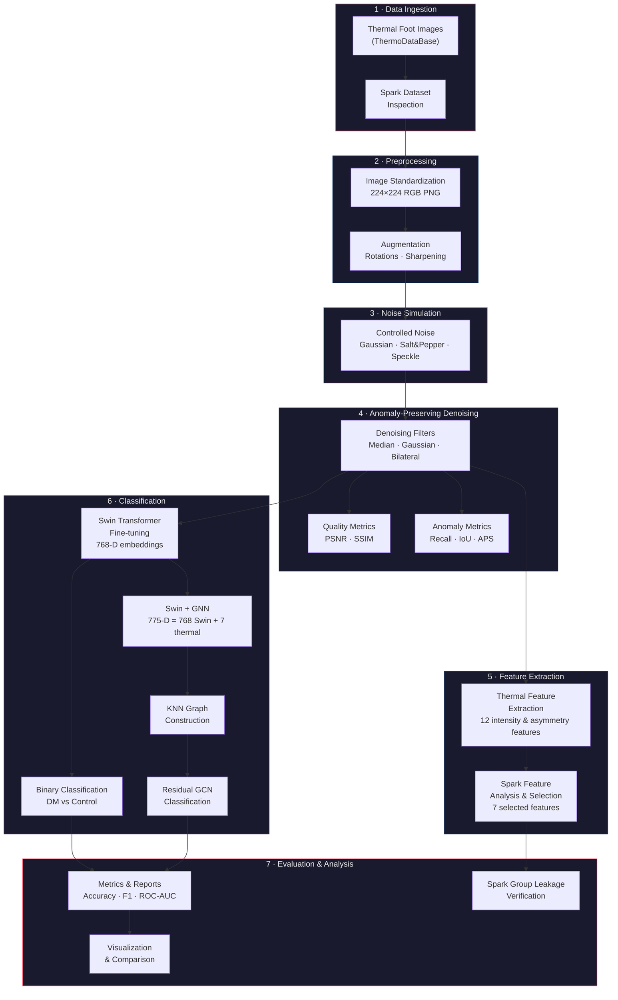
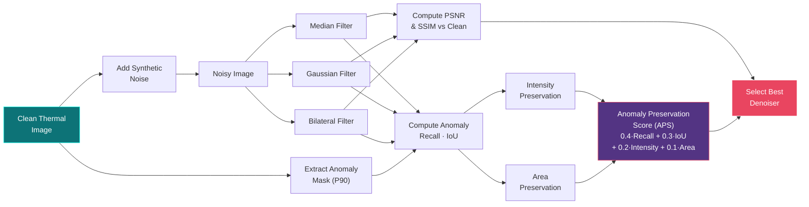
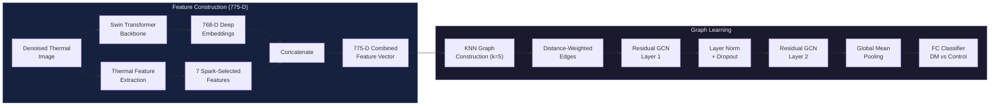
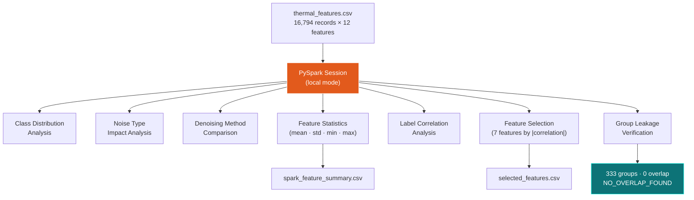
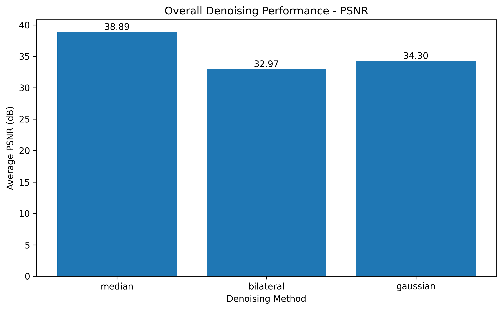
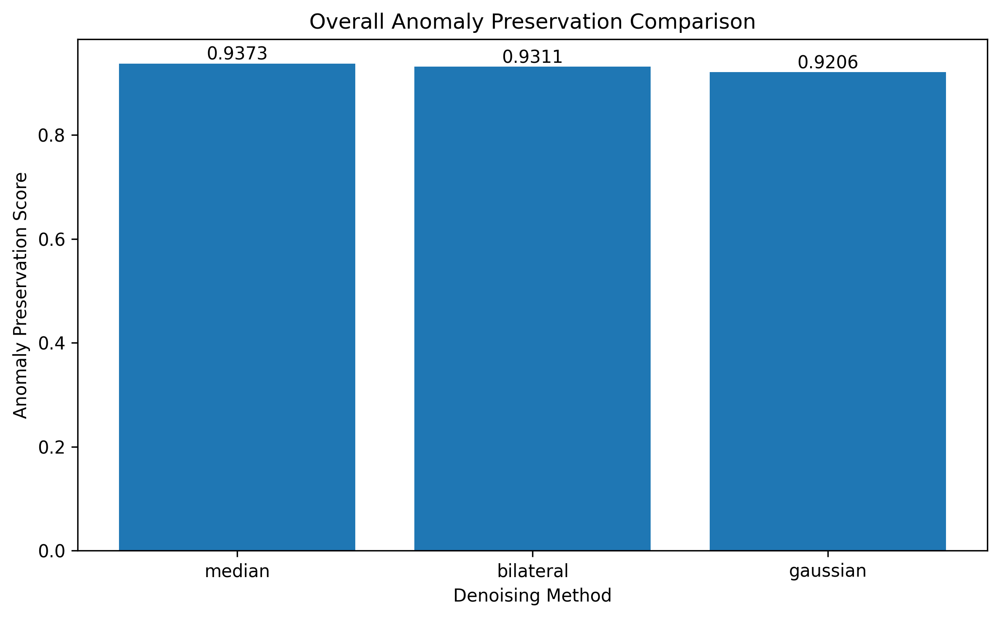
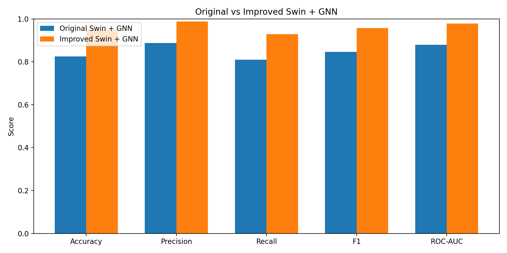
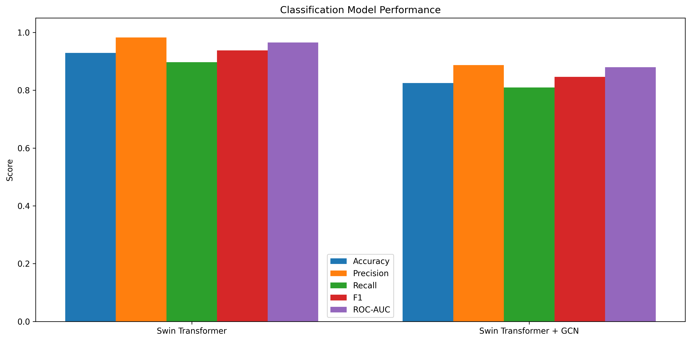

<p align="center">
  
  
  
  
  
</p>

---

<h1 align="center">🌡️ Anomaly-Preserving Thermal Image Denoising<br/>for Early Peripheral Neuropathy Risk Assessment</h1>

<p align="center">
  <em>A multi-stage research pipeline combining anomaly-preserving denoising, Swin Transformer embeddings, graph neural networks, and Big Data analytics to investigate thermal patterns in diabetic foot thermography.</em>
</p>

<p align="center">
  <strong>⚠️ Research Prototype</strong> — This is an academic research project, <strong>not</strong> a clinically validated diagnostic system.<br/>
  It does not diagnose diabetic peripheral neuropathy or replace professional medical assessment.
</p>

---

## 📑 Table of Contents

- [Research Abstract](#-research-abstract)
- [Problem Statement](#-problem-statement)
- [Dataset](#-dataset)
- [Architecture & Workflow](#-architecture--workflow)
- [Denoising Evaluation](#-denoising-evaluation)
- [Classification Results](#-classification-results)
- [Thermal Feature Engineering](#-thermal-feature-engineering)
- [Big Data & Technology Stack](#-big-data--technology-stack)
- [Repository Structure](#-repository-structure)
- [Setup & Reproducibility](#-setup--reproducibility)
- [Results Interpretation & Limitations](#-results-interpretation--limitations)
- [References & Citation](#-references--citation)
- [Acknowledgements & License](#-acknowledgements--license)

---

## 📄 Research Abstract

Thermal imaging (infrared thermography) of the plantar foot surface can reveal temperature distribution patterns that may differ between diabetic and healthy subjects. However, thermal images acquired in clinical or field settings are susceptible to sensor noise — Gaussian, salt-and-pepper, and speckle — that can degrade image quality and obscure subtle thermal patterns.

Conventional denoising methods (e.g., Gaussian smoothing) suppress noise effectively but risk removing **diagnostically relevant thermal anomalies** — localized high-intensity regions that may correspond to areas of altered blood flow or inflammation.

This project implements an **anomaly-preserving denoising pipeline** that evaluates multiple denoising strategies not only on traditional image-quality metrics (PSNR, SSIM) but also on a suite of **anomaly preservation metrics** (Anomaly Recall, IoU, Intensity Preservation, Area Preservation). These metrics quantify how well each denoising method retains thermal hotspots defined by the 90th-percentile intensity threshold of the clean reference image.

The denoised images are subsequently processed through:

1. **Swin Transformer** — pretrained feature extraction and fine-tuned binary classification (DM vs. Control).
2. **Graph Neural Network (GNN)** — combining 768-dimensional Swin embeddings with 7 Apache Spark-selected thermal features to build a k-nearest-neighbor graph over image representations, enabling relational reasoning across the dataset.
3. **Apache Spark (PySpark)** — large-scale feature analysis, statistical profiling, feature selection by label correlation, and group-level data leakage verification.

The intended research application is to investigate whether thermal patterns extracted from plantar foot thermograms — processed through anomaly-preserving denoising and hybrid deep-learning/graph-learning models — can contribute to assessing risk indicators associated with diabetic peripheral neuropathy.

---

## 🔬 Problem Statement

| Challenge | Description |
|:----------|:------------|
| **Noise in thermal images** | Infrared sensors introduce Gaussian, salt-and-pepper, and speckle noise that can mask subtle thermal gradients. |
| **Anomaly destruction by denoising** | Aggressive smoothing filters erase localized high-intensity hotspots that may carry diagnostic relevance. |
| **Feature representation gap** | Standard CNNs capture texture and shape but miss domain-specific thermal characteristics (asymmetry, hotspot ratios). |
| **Scalable analysis** | Analyzing thermal features across thousands of denoised image variants requires distributed data processing. |

**This project addresses these challenges** by designing a denoising evaluation framework that explicitly measures anomaly preservation, integrating handcrafted thermal features with deep Swin Transformer embeddings via graph-based learning, and leveraging Apache Spark for scalable feature analysis and data integrity verification.

---

## 📊 Dataset

The dataset consists of plantar foot thermal images organized into two classes — **DM** (diabetic) and **Control** (healthy) — with a predefined train/validation split.

### Dataset Summary

| Statistic | Value |
|:----------|------:|
| **Total Images** | 1,866 |
| **Diabetic (DM)** | 976 (52.3%) |
| **Control** | 890 (47.7%) |
| **Training Set** | 1,444 |
| — Train Control | 720 |
| — Train DM | 724 |
| **Validation Set** | 422 |
| — Val Control | 170 |
| — Val DM | 252 |
| **Image Dimensions** | 224 × 224 px (standardized) |
| **Image Format** | PNG |
| **Unique Image Groups** | 333 |
| **Group Overlap (Train↔Val)** | **0** (no leakage detected) |
| **Independent Test Set** | Not available |

> **Note on data splits:** The dataset provides a train/validation split only. There is no independent held-out test set. All classification metrics reported in this project are **validation-set** results. The augmentation strategy includes rotations and sharpening, yielding multiple variants per original image; a group-level leakage check confirmed **zero group overlap** between train and validation splits.

> **Note on provenance:** The original dataset source, detailed acquisition protocol, patient demographics, and data license are **not documented** in the current project files. The dataset folder name (`ThermoDataBase`) and its structure are preserved as received.

<p align="center">
  
</p>

---

## 🏗️ Architecture & Workflow

### End-to-End Project Pipeline



### Denoising & Anomaly Preservation Workflow



### Swin Transformer + GNN Integration



### Big Data Analytics Workflow



---

## 📈 Denoising Evaluation

### Metrics Explained

| Metric | Description |
|:-------|:------------|
| **PSNR** (dB) | Peak Signal-to-Noise Ratio — measures pixel-level reconstruction fidelity vs. the clean reference. Higher is better. |
| **SSIM** | Structural Similarity Index — captures perceptual similarity in luminance, contrast, and structure. Range [0, 1]. |
| **Anomaly Recall** | Fraction of original hotspot pixels (≥ P90 in clean image) retained after denoising. |
| **Anomaly IoU** | Intersection-over-Union between clean and denoised anomaly masks. |
| **Intensity Preservation** | 1 − |mean(clean hotspot) − mean(denoised hotspot)|. Measures how well hotspot brightness is preserved. |
| **Area Preservation** | 1 − |clean_area_ratio − denoised_area_ratio| / clean_area_ratio. Measures hotspot size stability. |
| **APS** | Anomaly Preservation Score = 0.40 × Recall + 0.30 × IoU + 0.20 × Intensity + 0.10 × Area. Composite anomaly fidelity. |

### Overall Denoising Comparison (Averaged Across All Noise Types)

| Method | PSNR (dB) | SSIM | Anomaly Recall | IoU | Intensity Pres. | Area Pres. | **APS** |
|:-------|----------:|-----:|---------------:|----:|----------------:|-----------:|--------:|
| **Median** | **38.89** | **0.9979** | 0.9304 | **0.8965** | 0.9957 | **0.9702** | **0.9373** |
| Bilateral | 32.97 | 0.9747 | **0.9361** | 0.8719 | **0.9964** | 0.9585 | 0.9311 |
| Gaussian | 34.30 | 0.9946 | 0.9134 | 0.8713 | 0.9930 | 0.9525 | 0.9206 |

> **Finding:** The **median filter** achieves the best overall balance — highest PSNR (38.89 dB), highest SSIM (0.9979), and highest composite Anomaly Preservation Score (0.9373). The bilateral filter provides marginally better anomaly recall (0.9361) and intensity preservation (0.9964) but at a significant PSNR cost.

### Best Denoiser by Noise Type (by Anomaly Preservation Score)

| Noise Type | Best Method | PSNR | SSIM | Anomaly Recall | IoU | **APS** |
|:-----------|:------------|-----:|-----:|---------------:|----:|--------:|
| Salt & Pepper | Median | 41.94 | 0.9987 | 0.9746 | 0.9623 | **0.9768** |
| Speckle | Bilateral | 42.30 | 0.9994 | 0.9258 | 0.8941 | **0.9340** |
| Gaussian | Gaussian | 34.34 | 0.9956 | 0.9241 | 0.8751 | **0.9277** |

<p align="center">
  
</p>
<p align="center">
  
</p>

> **Important:** These metrics compare denoised images against clean references and measure image-level fidelity. High PSNR/SSIM and anomaly preservation scores indicate successful noise removal with structural preservation, but they **do not** constitute evidence of clinical diagnostic accuracy.

---

## 🧠 Classification Results

### Model Comparison (Validation Set, n = 422)

| Model | Accuracy | Precision | Recall | F1-Score | ROC-AUC |
|:------|:--------:|:---------:|:------:|:--------:|:-------:|
| Swin Transformer (Step 8) | 92.89% | 98.26% | 89.68% | 93.78% | 96.53% |
| Swin + GCN — Original (Step 9) | 82.46% | 88.70% | 80.95% | 84.65% | 87.94% |
| **Improved Swin + GNN (Step 10)** | **95.02%** | **98.73%** | **92.86%** | **95.71%** | **97.86%** |

> **All results are on the validation set.** No independent test set is available. These metrics should be interpreted as validation performance, not generalization estimates.

### Improved Swin + GNN Details

The improved model combines:
- **768-D Swin Transformer embeddings** from the fine-tuned backbone
- **7 Spark-selected thermal features** (mean intensity, std intensity, P90, hotspot area ratio, hotspot mean intensity, absolute asymmetry, relative asymmetry)
- **KNN graph (k=5)** with distance-weighted edges
- **Residual GCN** with layer normalization, AdamW optimizer, label smoothing, cosine LR scheduling, gradient clipping, and early stopping

This improved configuration achieved a **+12.56%** accuracy gain and **+11.06%** F1-score gain over the original Swin + GCN baseline.

### Confusion Matrices

<table>
<tr>
<td align="center"><strong>Swin Transformer</strong></td>
<td align="center"><strong>Improved Swin + GNN</strong></td>
</tr>
<tr>
<td>

|  | Pred Control | Pred DM |
|:-|:-----------:|:-------:|
| **Actual Control** | 166 | 4 |
| **Actual DM** | 26 | 226 |

</td>
<td>

|  | Pred Control | Pred DM |
|:-|:-----------:|:-------:|
| **Actual Control** | 167 | 3 |
| **Actual DM** | 18 | 234 |

</td>
</tr>
</table>

<p align="center">
  
</p>

### Denoising → Classification Experiment (Step 11)

This experiment trains separate Swin Transformer classifiers on different denoising conditions to assess the impact of denoising on downstream classification:

| Condition | Accuracy | Precision | Recall | F1-Score | ROC-AUC |
|:----------|:--------:|:---------:|:------:|:--------:|:-------:|
| **Gaussian + Bilateral** | **83.18%** | 89.18% | **81.75%** | **85.30%** | **89.94%** |
| Clean (no noise/denoising) | 81.99% | 90.74% | 77.78% | 83.76% | 86.83% |
| Gaussian + Median | 81.99% | 90.74% | 77.78% | 83.76% | 88.68% |
| Gaussian Noise (no denoising) | 81.75% | 90.70% | 77.38% | 83.51% | 88.75% |
| Gaussian + Gaussian | 81.75% | 90.70% | 77.38% | 83.51% | 88.41% |

> **Observation:** The Gaussian + Bilateral denoising condition marginally outperforms all other conditions, including clean images. This suggests that bilateral denoising may enhance certain features useful for classification. However, the differences are small and based on a single validation split without statistical significance testing.

<p align="center">
  
</p>

---

## 🌡️ Thermal Feature Engineering

The following **12 features** are extracted from each denoised thermal image using the `thermal_features.py` module. All measurements are computed on **pixel intensity values** (0–255 scale) and represent **relative thermal patterns**, not calibrated absolute temperatures.

| Feature | Description | Diagnostic Rationale |
|:--------|:------------|:---------------------|
| `mean_intensity` | Mean pixel intensity across the entire image | Global thermal level proxy |
| `min_intensity` | Minimum pixel intensity | Coldest region indicator |
| `max_intensity` | Maximum pixel intensity | Hottest region indicator |
| `std_intensity` | Standard deviation of pixel intensities | Thermal heterogeneity measure |
| `percentile_90` | 90th-percentile intensity value | Hotspot threshold boundary |
| `hotspot_pixels` | Count of pixels ≥ P90 | Extent of high-intensity regions |
| `hotspot_area_ratio` | Hotspot pixels / total pixels | Normalized hotspot coverage |
| `hotspot_mean_intensity` | Mean intensity within hotspot mask | Average brightness of anomalous regions |
| `left_mean_intensity` | Mean intensity of left half of image | Left-right comparison baseline |
| `right_mean_intensity` | Mean intensity of right half of image | Left-right comparison baseline |
| `absolute_asymmetry` | |left_mean − right_mean| | Raw bilateral thermal difference |
| `relative_asymmetry` | absolute_asymmetry / average_side_intensity | Normalized bilateral thermal difference |

### Spark Feature Selection

Apache Spark computes Pearson correlation between each feature and the class label across all 16,794 feature records (1,866 images × 9 noise/denoising variants). The **7 features with highest absolute correlation** are selected for integration with Swin Transformer embeddings in the GNN model:

1. `mean_intensity`
2. `std_intensity`
3. `percentile_90`
4. `hotspot_area_ratio`
5. `hotspot_mean_intensity`
6. `absolute_asymmetry`
7. `relative_asymmetry`

> **Calibration note:** These features are derived from uncalibrated pixel intensities. The images have not been verified to carry absolute temperature mappings. All thermal interpretations should be treated as **image-intensity proxies** rather than direct physiological temperature measurements.

---

## ⚙️ Big Data & Technology Stack

| Technology | Version | Role in Project |
|:-----------|:--------|:----------------|
| **Python** | 3.10+ | Core programming language |
| **PyTorch** | 2.0+ | Deep learning framework — Swin Transformer fine-tuning, GCN layers |
| **Torchvision** | — | Pretrained Swin Transformer backbone, image transforms, data loading |
| **Apache Spark (PySpark)** | — | Distributed feature analysis, statistical profiling, feature selection, dataset inspection, group leakage verification |
| **OpenCV** | — | Median, Gaussian, and bilateral denoising filters; image I/O |
| **NumPy** | — | Array operations, noise generation, metric computation |
| **Pandas** | — | Tabular data manipulation, result aggregation |
| **Pillow (PIL)** | — | Image loading, format conversion, resizing |
| **scikit-learn** | — | KNN graph construction, StandardScaler, classification metrics (accuracy, precision, recall, F1, ROC-AUC, confusion matrix) |
| **Matplotlib** | — | Training curves, metric comparisons, confusion matrices, ROC curves |
| **CUDA** | — | GPU-accelerated training (tested on NVIDIA RTX 4060 Laptop GPU) |

### Where Big Data (Spark) Is Used

Apache Spark is used in **three specific stages** of this project — not for training the deep learning models:

1. **Dataset Inspection** (`src/bigdata/dataset_inspection.py`) — Spark-based cataloging of the entire dataset, collecting image metadata into a structured DataFrame for downstream analysis.

2. **Feature Analysis & Selection** (`src/bigdata/spark_feature_analysis.py`) — Statistical profiling of 16,794 thermal feature records (12 features × 1,866 images × 9 denoising variants). Spark computes per-class distributions, noise-type impact analysis, denoising-method comparisons, global statistics, and label correlations to select the 7 most informative features.

3. **Group Leakage Verification** (`src/bigdata/group_leakage_check.py`) — Verifying that no image group (base subject + augmentation family) appears in both training and validation splits. Result: **0 overlapping groups** out of 333 total.

---

## 📁 Repository Structure

```
├── archive/
│   └── ThermoDataBase/              # Original dataset
│       ├── train/
│       │   ├── Control Group/
│       │   └── DM Group/
│       └── val/
│           ├── Control Group/
│           └── DM Group/
├── data/
│   ├── features/                    # Extracted & selected thermal features
│   │   ├── thermal_features.csv
│   │   ├── spark_feature_summary.csv
│   │   └── selected_features.csv
│   └── processed/
│       ├── standardized/            # 224×224 preprocessed images
│       ├── noisy/                   # Synthetically noised images
│       ├── denoised_fast/           # Denoised outputs (median/gaussian/bilateral)
│       ├── classification/          # Classification-ready splits
│       └── *.csv                    # Processing metadata
├── models/
│   ├── baseline/
│   ├── classification/              # Saved model checkpoints (.pth)
│   └── denoising/
├── results/
│   ├── metrics/                     # CSVs: classification reports, confusion matrices, denoising results
│   ├── plots/                       # Training curves, ROC curves, comparison charts
│   ├── final_plots/                 # Publication-ready figures
│   ├── powerbi/                     # PowerBI-compatible summary CSVs
│   ├── ppt/                         # Presentation assets
│   └── images/                      # Pipeline visualization examples
├── src/
│   ├── preprocessing/
│   │   ├── dataset_inspection.py    # Step 1: dataset cataloging
│   │   └── preprocess_images.py     # Step 2: image standardization
│   ├── denoising/
│   │   ├── noise_generation.py      # Step 3: controlled noise addition
│   │   └── anomaly_preserving_denoising_fast.py  # Step 4: denoising + anomaly metrics
│   ├── features/
│   │   └── thermal_features.py      # Step 5: thermal feature extraction
│   ├── bigdata/
│   │   ├── dataset_inspection.py    # Step 1 (Spark): distributed dataset inspection
│   │   ├── spark_feature_analysis.py # Step 6: Spark feature analysis & selection
│   │   ├── group_leakage_check.py   # Step 13: train/val group leakage check
│   │   ├── create_final_visualizations.py  # Final figure generation
│   │   └── prepare_powerbi_data.py  # PowerBI data export
│   ├── classification/
│   │   ├── prepare_classification_dataset.py  # Step 7: classification dataset prep
│   │   ├── train_swin_transformer.py          # Step 8: Swin Transformer training
│   │   ├── swin_gnn_integration.py            # Step 9: Swin + GCN baseline
│   │   ├── improved_swin_gnn.py               # Step 10: improved Swin + GNN
│   │   ├── denoising_classification_experiment.py # Step 11: denoising→classification
│   │   ├── final_integrated_pipeline.py       # Step 12: end-to-end inference pipeline
│   │   └── evaluate_models.py                 # Model evaluation utilities
│   └── evaluation/
│       └── generate_ppt_results.py  # Presentation result generation
├── docs/
│   └── images/                      # README figures
├── project/
│   └── IEEE_Conference_Template.pdf # Conference paper template
└── README.md
```

---

## 🚀 Setup & Reproducibility

### Prerequisites

- **Python 3.10+** with pip
- **NVIDIA GPU** with CUDA support (tested on RTX 4060 Laptop GPU; CPU fallback available but slow)
- **Apache Spark** (Java 8/11 JDK required for PySpark)
- **Git**

### 1. Clone the Repository

```bash
git clone https://github.com/ashutosh2453/Anomaly-Preserving-Thermal-Image-Denoising-for-Early-Peripheral-Neuropathy-Risk-Assessment.git
cd Anomaly-Preserving-Thermal-Image-Denoising-for-Early-Peripheral-Neuropathy-Risk-Assessment
```

### 2. Create Virtual Environment (Windows)

```powershell
python -m venv venv
.\venv\Scripts\activate
```

### 3. Install Dependencies

There is no `requirements.txt` in the current repository. Install the core dependencies manually based on the project imports:

```powershell
pip install torch torchvision --index-url https://download.pytorch.org/whl/cu121
pip install numpy pandas scikit-learn matplotlib seaborn pillow opencv-python pyspark
```

> **Note:** Adjust the CUDA version in the PyTorch install URL to match your local CUDA toolkit. See [pytorch.org/get-started](https://pytorch.org/get-started/locally/) for details.

### 4. Dataset Placement

Place the thermal image dataset under `archive/ThermoDataBase/` with the following structure:

```
archive/ThermoDataBase/
├── train/
│   ├── Control Group/
│   └── DM Group/
└── val/
    ├── Control Group/
    └── DM Group/
```

### 5. Verify GPU Availability

```python
python -c "import torch; print(f'CUDA: {torch.cuda.is_available()}, GPU: {torch.cuda.get_device_name(0) if torch.cuda.is_available() else \"N/A\"}')"
```

### 6. Run the Pipeline

The pipeline is designed to execute in sequential steps. Each script reads outputs from the previous step:

```powershell
# Step 1: Dataset inspection (Spark)
python src/bigdata/dataset_inspection.py

# Step 2: Image preprocessing & standardization
python src/preprocessing/preprocess_images.py

# Step 3: Synthetic noise generation
python src/denoising/noise_generation.py

# Step 4: Anomaly-preserving denoising
python src/denoising/anomaly_preserving_denoising_fast.py

# Step 5: Thermal feature extraction
python src/features/thermal_features.py

# Step 6: Spark feature analysis & selection
python src/bigdata/spark_feature_analysis.py

# Step 8: Swin Transformer classification training (requires GPU)
python src/classification/train_swin_transformer.py

# Step 10: Improved Swin + GNN (requires Step 8 checkpoint)
python src/classification/improved_swin_gnn.py

# Step 11: Denoising→Classification experiment
python src/classification/denoising_classification_experiment.py

# Step 12: Final integrated pipeline
python src/classification/final_integrated_pipeline.py

# Step 13: Group leakage verification
python src/bigdata/group_leakage_check.py
```

> **Important:** Some scripts contain hardcoded paths relative to the project root. If you move the project, update `PROJECT_ROOT` or verify that `Path(__file__).resolve().parents[2]` resolves correctly. Steps 8–11 require significant GPU time.

### 7. Review Existing Results

Pre-computed results are available in `results/`:

- **Classification metrics:** `results/metrics/classification_model_comparison.csv`
- **Denoising results:** `results/metrics/overall_denoising_comparison.csv`
- **Training histories:** `results/metrics/*_training_history.csv`
- **Confusion matrices:** `results/metrics/*_confusion_matrix.csv`
- **Plots & figures:** `results/plots/` and `results/final_plots/`

---

## ⚖️ Results Interpretation & Limitations

### What the Results Show

1. **Image-quality improvement:** All denoising methods substantially improve PSNR and SSIM over noisy inputs, confirming effective noise suppression.

2. **Anomaly preservation:** Median and bilateral filters retain >93% of thermal hotspot structures (by APS), demonstrating that denoising need not destroy diagnostically relevant patterns.

3. **Classification performance:** The improved Swin + GNN model achieves 95.02% validation accuracy by combining deep visual features with handcrafted thermal descriptors through graph-based relational learning.

4. **Denoising benefits classification:** The Gaussian + Bilateral denoised condition modestly outperforms clean images in downstream classification, suggesting that structured denoising may enhance discriminative thermal features.

### Key Limitations

| Limitation | Details |
|:-----------|:--------|
| **No independent test set** | All classification results are validation-set metrics. Generalization to unseen data is not established. |
| **No external clinical validation** | The project is a computational research prototype. No clinical study, IRB approval, or regulatory evaluation has been conducted. |
| **Dataset size** | 1,866 images (333 unique image groups) is modest for deep learning. Results may not generalize to larger, more diverse populations. |
| **Augmentation-level splitting** | While group leakage is verified as zero, augmented variants of the same base image exist only within a single split. The definition of "group" is inferred from filename patterns and may not perfectly map to patient-level independence. |
| **No absolute temperature calibration** | All thermal features are image-intensity proxies. Without radiometric calibration, absolute physiological temperature interpretations are not supported. |
| **Single validation split** | No cross-validation or repeated random splits were performed. Results may be sensitive to the specific train/val partition. |
| **Limited denoising methods** | Only three classical filters were evaluated. Advanced learned denoisers (e.g., DnCNN, U-Net) were not explored. |

### Distinction Between Metrics

- **PSNR/SSIM** measure image reconstruction quality — not clinical utility.
- **Anomaly Preservation Score** measures retention of thermal hotspots — not diagnostic relevance.
- **Classification accuracy/F1** measures model discrimination on this dataset — not clinical diagnostic accuracy.

These layers of evaluation are complementary but should not be conflated with clinical validation.

---

## 📚 References & Citation

The following references are relevant to the methods and tools used in this project:

1. **Swin Transformer:** Liu, Z., Lin, Y., Cao, Y., Hu, H., Wei, Y., Zhang, Z., Lin, S., & Guo, B. (2021). *Swin Transformer: Hierarchical Vision Transformer using Shifted Windows.* ICCV 2021. [arXiv:2103.14030](https://arxiv.org/abs/2103.14030)

2. **Graph Convolutional Networks:** Kipf, T. N., & Welling, M. (2017). *Semi-Supervised Classification with Graph Convolutional Networks.* ICLR 2017. [arXiv:1609.02907](https://arxiv.org/abs/1609.02907)

3. **SSIM:** Wang, Z., Bovik, A. C., Sheikh, H. R., & Simoncelli, E. P. (2004). *Image quality assessment: from error visibility to structural similarity.* IEEE Transactions on Image Processing, 13(4), 600–612. [DOI:10.1109/TIP.2003.819861](https://doi.org/10.1109/TIP.2003.819861)

4. **Thermal Imaging in Diabetic Foot:** Hernandez-Contreras, D., Peregrina-Barreto, H., Rangel-Magdaleno, J., & Gonzalez-Bernal, J. (2016). *Narrative review: Diabetic foot and infrared thermography.* Infrared Physics & Technology, 78, 105–117.

5. **Apache Spark:** Zaharia, M., Chowdhury, M., Franklin, M. J., Shenker, S., & Stoica, I. (2010). *Spark: Cluster Computing with Working Sets.* HotCloud 2010.

> **Note:** The specific dataset provenance and original publication are not documented in the current project files. If the dataset has a citable source, it should be added here.

---

## 👏 Acknowledgements & License

This project was developed as an academic research exploration into thermal image analysis for diabetic peripheral neuropathy risk assessment.

**Contributors:** See the repository commit history for contributor information.

**License:** Not specified in the current repository. Please contact the repository owner for licensing information before reuse.

---

<p align="center">
  <sub>Built with PyTorch · Apache Spark · Swin Transformer · Graph Neural Networks</sub>
</p>
